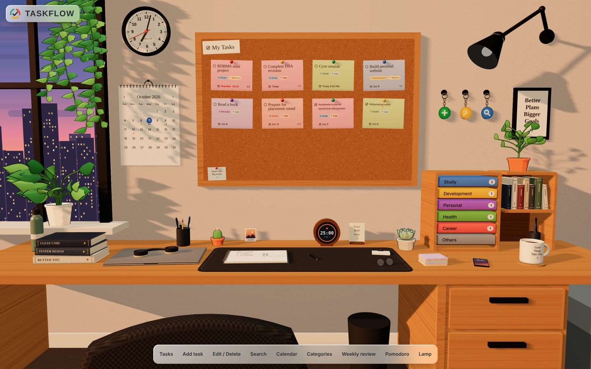
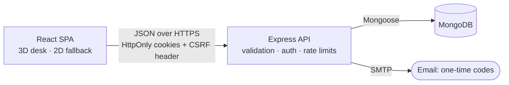

<div align="center">


# TaskFlow

**A personal task manager that lives on a 3D desk.**

Tasks are sticky notes on a corkboard, deadlines hang on a wall calendar, categories sit in trays on the shelf,
and a Pomodoro clock ticks beside your notebook.

[](https://github.com/shreyans-chordia/taskflow/actions/workflows/ci.yml)
[](https://github.com/shreyans-chordia/taskflow/actions/workflows/codeql.yml)
[](LICENSE)


[Features](#features) · [Getting started](#getting-started) · [Architecture](#architecture) ·
[Security](#security) · [Documentation](#documentation)

</div>

<picture>
  <source media="(prefers-color-scheme: dark)" srcset="web/public/backdrop-dark.jpg" />
  
</picture>

## Why TaskFlow

Most to-do apps are a list in a box. TaskFlow turns your tasks into a room you can look around: everything you need
is an object on the desk, and clicking it flies the camera over and opens the matching panel. Underneath the
playful surface is a conventional, well-tested stack built to the standard of a public web service: strict input
validation, cookie-only sessions, two-step sign-in and per-account data isolation proven by tests.

## Features

**Tasks**
- Create, edit and delete tasks with a title, description, categories, deadline (date and optional time) and priority
- A live sticky-note preview while you write
- Checklist subtasks with progress shown on the note (`2/5`)
- Overdue tasks are flagged; finished ones get a hand-drawn scribble

**Organise**
- Custom categories: rename, recolour, reorder; the first six become trays on the shelf
- Custom priority levels: Low, Medium and High out of the box, plus your own. Priority is always your call;
  nothing ranks tasks for you
- A month calendar of deadlines and a keyword search with category, priority and status filters
- A weekly review in the notebook: what got done each day, what is still open, broken down by level and category

**Focus**
- A Pomodoro timer on the desk clock with 15 / 25 / 45 / 60-minute presets or custom lengths, automatic breaks,
  a chime and toasts. It keeps running while you work and is deliberately independent of your tasks

**Experience**
- An interactive 3D room built with three.js; every texture is painted procedurally, so it ships no image or model
  assets
- A complete 2D interface for browsers without WebGL, with the same features
- Light and dark themes, responsive down to phone width, and reduced-motion support

**Accounts**
- Two-step sign-in with an emailed one-time code, and password reset by code
- The API also supports signing out of every device and deleting an account with all its data

## Tech stack

| Layer | Technology |
| --- | --- |
| Front end | React 19, TypeScript, Vite 7, TanStack Query |
| 3D | three.js, React Three Fiber, Motion |
| API | Node.js 20+, Express 5, TypeScript |
| Data | MongoDB 7 with Mongoose 8 |
| Validation | zod 4, strict schemas on every request |
| Auth | bcrypt, JWT access token + rotating refresh token in HttpOnly cookies, double-submit CSRF tokens, emailed one-time codes |
| Email | Nodemailer over SMTP |
| Testing | Vitest, Testing Library, Supertest, mongodb-memory-server, Playwright |
| CI | GitHub Actions (lint, typecheck, tests, build, `npm audit`, end-to-end), CodeQL, gitleaks, Dependabot |

## Getting started

### Prerequisites

- [Node.js](https://nodejs.org) 20.11 or newer (22 LTS recommended)
- MongoDB: [Docker Desktop](https://www.docker.com/products/docker-desktop/) for a local instance, or a free
  [MongoDB Atlas](https://www.mongodb.com/atlas) cluster

### 1. Clone and start MongoDB

```bash
git clone https://github.com/shreyans-chordia/taskflow.git
cd taskflow
docker compose up -d mongo        # MongoDB 7 on 127.0.0.1:27017
```

### 2. Configure and run the API

```bash
cd server
npm install
cp .env.example .env              # PowerShell: Copy-Item .env.example .env
node -e "console.log(require('crypto').randomBytes(48).toString('base64url'))"
```

Paste the printed value into `.env` as `JWT_ACCESS_SECRET` (the API refuses to start with the placeholder), then:

```bash
npm run dev                       # http://localhost:4000
```

`http://localhost:4000/api/health` should return `{"ok":true}`. In development no email is sent: sign-in codes
are printed in this terminal. To send real email, see [Email](#email).

### 3. Run the web app

In a second terminal:

```bash
cd web
npm install
npm run dev                       # http://localhost:5173, proxies /api to :4000
```

Open `http://localhost:5173` and create an account. New accounts start with a default set of categories and
priority levels.

## Configuration

The API reads its settings from `server/.env` and validates every one at start-up; it exits with a clear message
rather than run with an unsafe configuration. See [`server/.env.example`](server/.env.example) for the full list.

| Variable | Default | Purpose |
| --- | --- | --- |
| `MONGODB_URI` | – | MongoDB connection string (required) |
| `JWT_ACCESS_SECRET` | – | Signing key, at least 32 random characters (required) |
| `CORS_ORIGINS` | `http://localhost:5173` | Comma-separated browser origins allowed to call the API |
| `ACCESS_TOKEN_TTL_MIN` / `REFRESH_TOKEN_TTL_DAYS` | `15` / `30` | Session lifetimes |
| `COOKIE_SAMESITE` | `lax` | `none` only when the web app and API are on different domains (production, HTTPS) |
| `TRUST_PROXY` | `0` | Number of reverse proxies in front of the API, so rate limits see real client IPs |
| `MAIL_TRANSPORT` | `console` in development, `smtp` in production | Where one-time codes go |
| `SMTP_*`, `MAIL_FROM` | – | SMTP server for real email |
| `OTP_TTL_MIN` | `10` | Minutes a one-time code stays valid |

### Email

Sign-in and reset codes are sent over SMTP. Any provider works; with Gmail, turn on 2-Step Verification, create an
[App Password](https://myaccount.google.com/apppasswords), and set:

```ini
MAIL_TRANSPORT=smtp
SMTP_HOST=smtp.gmail.com
SMTP_PORT=587
SMTP_SECURE=false
SMTP_USER=you@gmail.com
SMTP_PASS=your-16-letter-app-password
MAIL_FROM=TaskFlow <you@gmail.com>
```

Port 587 must upgrade with STARTTLS (use `SMTP_SECURE=true` for port 465). In production the API will not start
without SMTP settings, so sign-in can never silently stop working.

## Testing

| Suite | Where | Command | Notes |
| --- | --- | --- | --- |
| API integration | `server/` | `npm test` | Starts its own in-memory MongoDB; no Docker needed |
| Web unit | `web/` | `npm test` | jsdom + Testing Library |
| End to end | `web/` | `npm run e2e` | Real browser → Vite → API → MongoDB; covers the 3D desk and the no-WebGL fallback |

Both packages also have `npm run lint` and `npm run typecheck`. Before the first end-to-end run, install the browser
with `npx playwright install chromium`; the suite uses its own ports (4100, 5174) and its own database.

Over 240 tests cover the API, the UI and full user journeys. Test names carry the requirement they verify (for
example `TASK-6`, `AUTH-7`); the catalogue is in [`docs/REQUIREMENTS.md`](docs/REQUIREMENTS.md).

## Architecture



```
server/      REST API: config, models, zod schemas, controllers, middleware, services, integration tests
web/         React app: API client, auth, 3D desk, 2D workbench, task screens, timer, design tokens, e2e specs
prototype/   single-file design prototype the React app was built from
docs/        API contract, security model, requirements, architecture
```

The data model, front-end structure and design system are described in
[`docs/ARCHITECTURE.md`](docs/ARCHITECTURE.md).

## Security

Security is treated as a feature, and every control is documented and tested:

- **Sessions**: 15-minute JWT access token and a rotating refresh token, both in `HttpOnly` cookies with
  `__Host-` / `__Secure-` prefixes in production. Refresh-token reuse revokes the whole token family.
- **Sign-in**: two steps with an emailed one-time code bound to the requesting browser; account lockout, per-IP rate
  limits and timing-safe responses that do not reveal whether an email is registered.
- **Requests**: double-submit CSRF tokens plus an `Origin` allow-list, strict zod schemas that reject unknown fields,
  NoSQL-injection protection, payload size limits and Helmet headers.
- **Data**: bcrypt password hashes, refresh tokens and codes stored only as hashes, and every query scoped to the
  signed-in account, with tests proving one account cannot reach another's data.
- **Configuration**: validated at boot; weak or placeholder secrets and unsafe cookie settings are refused.

The full threat model and known gaps are in [`docs/SECURITY.md`](docs/SECURITY.md). To report a vulnerability,
please follow the [security policy](.github/SECURITY.md).

## Deploying

TaskFlow runs anywhere Node.js and MongoDB do (for example Render or Railway with MongoDB Atlas). For production:

1. Build the API with `npm run build` and start it with `npm start` and `NODE_ENV=production`.
2. Set a fresh `JWT_ACCESS_SECRET`, real SMTP settings and `CORS_ORIGINS` to your web app's origin.
3. Serve the API over HTTPS. If the web app is on another domain, set `COOKIE_SAMESITE=none`; behind a proxy, set
   `TRUST_PROXY`.
4. Build the web app with `npm run build` and serve `web/dist` from a static host, with a Content-Security-Policy of
   `default-src 'self'` plus the Google Fonts origins.

## Documentation

| Document | Contents |
| --- | --- |
| [`docs/ARCHITECTURE.md`](docs/ARCHITECTURE.md) | System design, data model, front-end structure, design system |
| [`docs/API.md`](docs/API.md) | Every endpoint, request and response |
| [`docs/SECURITY.md`](docs/SECURITY.md) | Threat model, controls and known gaps |
| [`docs/REQUIREMENTS.md`](docs/REQUIREMENTS.md) | Requirement catalogue referenced by the tests |
| [`CONTRIBUTING.md`](CONTRIBUTING.md) | Development workflow and engineering rules |

## Roadmap

- [ ] Account settings in the UI: sign out of every device, delete account
- [ ] Verify the email address at sign-up
- [ ] Authenticator-app (TOTP) or passkey sign-in as a stronger second factor
- [ ] Shared rate-limit store (Redis) for running more than one API instance
- [ ] Public demo deployment

## Contributing

Issues and pull requests are welcome. Please read [`CONTRIBUTING.md`](CONTRIBUTING.md) first; it explains the
checks CI runs and the rules that keep the security model intact.

## License

[MIT](LICENSE) © Shreyans Chordia. The RubberSegment component is adapted from
[React Bits](https://github.com/DavidHDev/react-bits) under its own license; see
[`THIRD_PARTY_NOTICES.md`](THIRD_PARTY_NOTICES.md).
