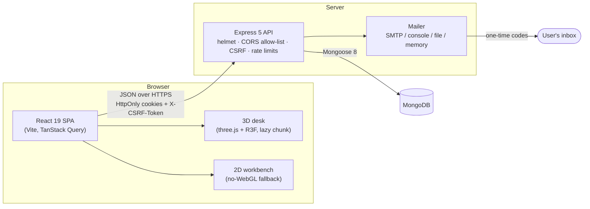
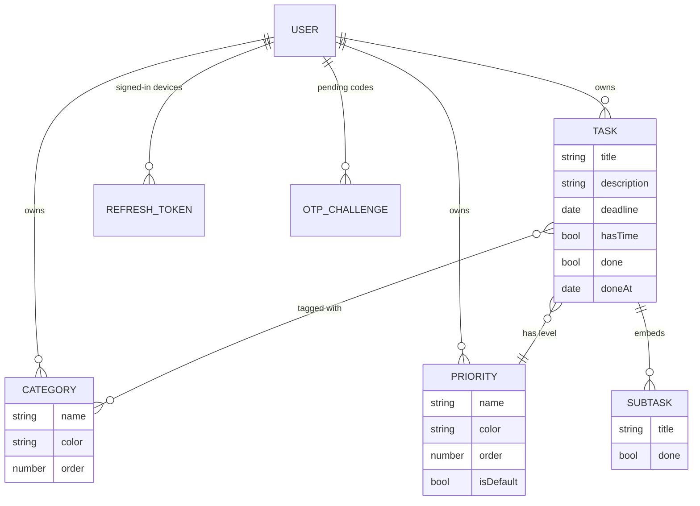

# Architecture

TaskFlow is a three-tier web application: a React single-page app, a stateless Express REST API, and MongoDB.
The browser never holds a session token in JavaScript; everything sensitive lives in HttpOnly cookies.



## Repository layout

```
taskflow/
├── server/            REST API (TypeScript, Express 5, Mongoose 8, zod 4)
│   ├── src/
│   │   ├── config/        env.ts: every setting validated once at boot
│   │   ├── models/        User, Task (with embedded subtasks), Category, Priority, RefreshToken, OtpChallenge
│   │   ├── schemas/       zod request schemas (strict: unknown fields are rejected)
│   │   ├── controllers/   auth, tasks, categories, priorities
│   │   ├── routes/        route table under /api
│   │   ├── middleware/    requireAuth, CSRF, rate limits, error handling
│   │   ├── services/      passwords, tokens, cookies, one-time codes, mailer, account seed data
│   │   ├── db/            connection (sanitizeFilter on)
│   │   └── utils/         logger with secret redaction
│   └── tests/         integration tests (Vitest + Supertest + mongodb-memory-server)
├── web/               React front end (TypeScript, Vite 7)
│   ├── src/
│   │   ├── api/           fetch client: cookies, CSRF header, refresh-and-retry
│   │   ├── auth/          sign-up, two-step sign-in, password reset
│   │   ├── home/          the signed-in screen: 3D desk, or the 2D workbench as fallback
│   │   ├── desk/          the 3D room and its clickable objects
│   │   ├── workbench/     the 2D page
│   │   ├── tasks/         corkboard, task detail/form, calendar, search, categories, organizer, weekly review
│   │   ├── timer/         the Pomodoro timer
│   │   ├── components/    shared UI (the Ring, colour picker, popovers, segmented control)
│   │   └── styles/        design tokens and dark mode
│   └── e2e/           Playwright end-to-end specs
├── prototype/         single-file design prototype (room.html), the visual reference for the React app
└── docs/              API contract, security model, requirements, this file
```

## Data model

Every document except `User` carries a `userId`, and every query is scoped by the `userId` taken from the verified
access token. Subtasks are embedded in their task, so deleting a task removes its checklist in the same write.



The Pomodoro timer has no model at all: it is a client-side store that imports nothing from tasks or the API, by
design (requirement POM-5).

## Back end

- **Configuration** is parsed with zod at start-up. The process refuses to boot with a missing, short or placeholder
  JWT secret, with `SameSite=None` outside production, or without SMTP settings in production.
- **Validation**: every request body and query string goes through a `z.strictObject` schema. Mongoose
  `sanitizeFilter` is on; the few intentional operators are marked with `mongoose.trusted()`.
- **Authentication**: sign-in is two steps. `POST /auth/login` checks the password and only emails a six-digit code;
  `POST /auth/login/verify` exchanges the code for a session. Sessions are a 15-minute JWT access token plus a
  rotating refresh token (stored server-side only as a SHA-256 hash, with reuse detection per token family).
- **Email** goes through one `mailer` service with four transports: `smtp` (production), `console` (local
  development), `file` (end-to-end tests read codes from disk) and `memory` (integration tests).
- The full threat model is in [`SECURITY.md`](SECURITY.md); the endpoint contract is in [`API.md`](API.md).

## Front end

- **Server state** lives in TanStack Query. All task mutations go through one hook (`useTaskActions`); checklist ticks
  and reorders are optimistic.
- **Navigation** inside a panel is a small stack (list, calendar or search → task → edit). Each screen keeps its own
  state, such as the visible month or the active filters, in its stack entry, so Back restores it exactly.
- **The 3D desk** is a lazily loaded chunk built with three.js and React Three Fiber. Every texture is painted
  procedurally on canvases, so the scene ships no image or model files. The canvas renders on demand
  (`frameloop="demand"`), camera flights advance inside the frame loop, and shadow maps skip camera-only frames.
  `desk/model.ts` turns API data into what the desk paints and is unit-tested on its own.
- **Fallback**: when WebGL is unavailable, or the desk throws, the app renders the same screens as a 2D page with tabs.
  Playwright covers both paths.
- **Timer**: `timer/pomodoro.ts` is a store outside React that counts down from an end timestamp (so it stays accurate
  in background tabs), starts the break itself and chimes with WebAudio.

## Design system

| Token | Value | Use |
| --- | --- | --- |
| Graphite | `#2B2E33` | linework and text |
| Pen Blue | `#2F4E7A` | every interactive affordance |
| Sticky Coral | `#E04A2F` | High priority |
| Sticky Amber | `#F0A81C` | Medium priority (default) |
| Sticky Mint | `#4E9E78` | Low priority |

Type: Caveat (handwritten titles), Barlow Condensed (labels), Inter (body), JetBrains Mono (numbers).
The recurring motif is **the Ring**, a segmented arc used for the timer dial, checklist progress, the priority marker
and the logo. Dark mode is a pure token swap in `web/src/styles/tokens.css`; no component has a separate dark variant.
